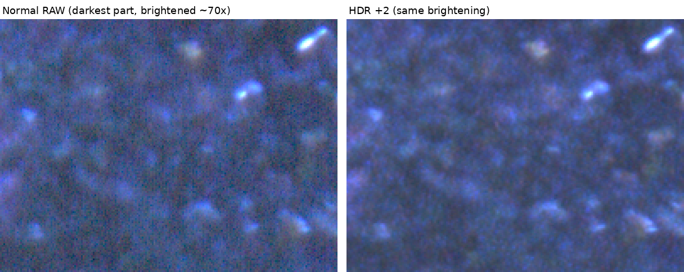
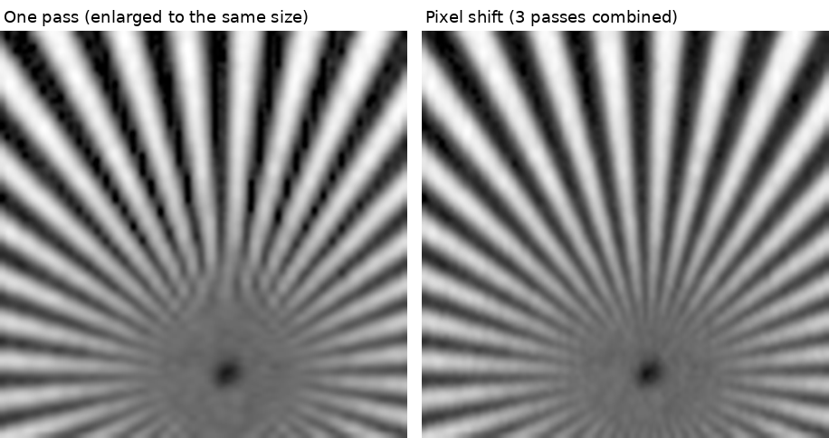
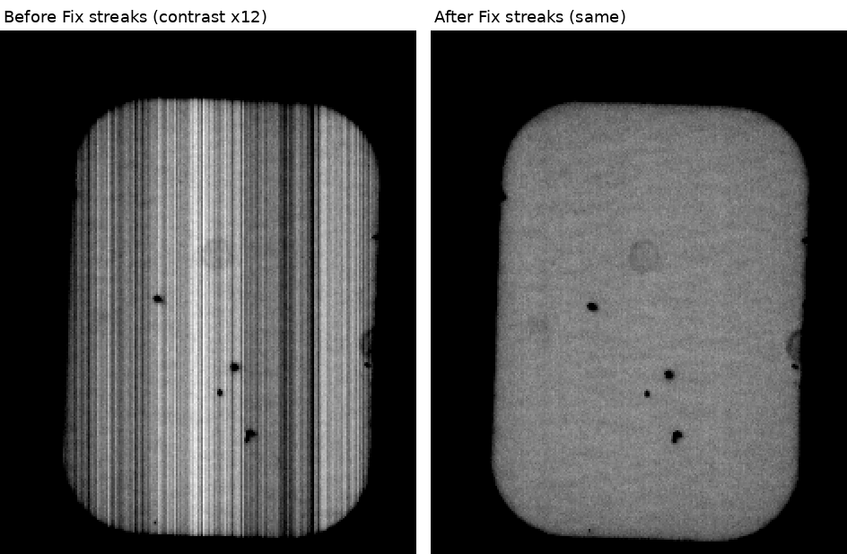
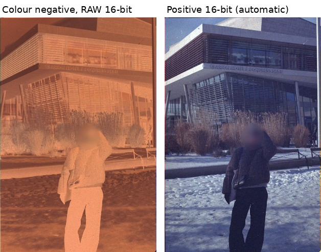

# Smart342 for Windows

Smart342 for Windows lets you use a **Scitex Smart 342 / 342L** film scanner with a normal Windows PC. It runs Scitex's own scanner software inside the program, so the scanner works exactly as it did on its original Macintosh - and it adds RAW 16-bit files, HDR, negative conversion and more.

**Version 0.5.0 - a public test version.** So far it has been used with one scanner. If you try it, please tell us how it went (see "If something goes wrong").

**Download:** [Releases](../../releases) - get `Smart342-for-Windows-0.5.0.zip`.

Not affiliated with Scitex, Creo or Kodak.

## What it adds to the scanner

Everything the original software did still works the same way. On top of that:

- **RAW 16-bit TIFF** - the scanner's own data with its full precision (up to 14 bits in the shadows), before any colour table, curve or sharpening. The most editing latitude the scanner can give.
- **HDR** - a second, longer exposure merged into the shadows: about 2 to 3 times less noise in the darkest parts, lined up precisely with the first pass.
- **Pixel shift** - the lens is moved by a fraction of a pixel between passes and the passes are combined: twice the resolution across the scan (up to 5324 dpi with the 35 mm lens), with real extra detail.
- **Step-and-hold** - the scanner's carriage stands still while each line is exposed, so the picture is sharper along the scan.
- **Averaging** - several passes of the same frame averaged for less noise.
- **RAW sharpening** - an extra copy sharpened to undo the softness of the scanner's lens (measured on your own scanner if you run Set up with the Scitex focus chart).
- **Colour registration** - red and blue lined up exactly with green in every RAW.
- **Negatives** - colour negatives turned into a ready-to-edit positive TIFF automatically (orange mask removed, neutral colours), with a long-exposure option for dense film.
- **Fix streaks** - measures your own scanner and removes the fine streaks along the scan (from about 1 % to under 0.1 %).
- **Safe by design** - the program never changes anything stored in the scanner.

## Examples

All from real scans on a Smart 342L. Each pair shows the same part of the same frame, processed the same way.

**HDR** - the darkest part of a slide, brightened about 70 times. Noise in the HDR is 2.5 - 3 times lower (red and green).

**Pixel shift** - a focus chart (Siemens star) with the 35 mm lens. One pass breaks up the fine spokes near the centre; pixel shift keeps them (10 % contrast at 33.9 instead of 26.6 line pairs per mm across the scan).

**Fix streaks** - an empty frame with the contrast raised 12 times. Streaks along the scan: 0.98 % before, 0.08 % after.

**Negatives** - a colour negative scanned as RAW and the positive the program made from it, without any editing.

## What you need

- **A Windows PC** - Windows 10 or 11, 64-bit, with an Intel or AMD processor.
- **A SCSI card** in the PC, with its Windows driver installed. Most SCSI cards that have a Windows 10 / 11 driver should work.
- **A SCSI cable** from the card to the scanner (and the scanner's terminator, as always).

That is all - the Scitex software comes with the program. More about SCSI cards: see [SCSI cards in detail](docs/user-guide.md#scsi-cards-in-detail).

## Getting started

1. Unpack the zip file anywhere, for example to your desktop.
2. Switch the scanner on and wait for its steady green light.
3. Start **smart342.exe**. Windows asks for permission (it needs to reach the SCSI card) - answer **Yes**. If Windows says the program is from an unknown publisher: **More info > Run anyway**.
4. The program finds the scanner by itself.
5. The first time, it offers to **copy your scanner's settings** from the scanner into the program. Choose that. The program restarts by itself.
6. Wait until the bottom of the window says **Ready**.

The first time, the program also offers **Set up this scanner** (a few minutes per lens). You can do it now or later from the Tools menu.

## Scanning

1. Choose **Original** (Transparent or Reflective), **Cassette** (the film holder you put in), **Mode** (Colour or Greyscale) and **Media** (Positive or Negative). Press **Preview**.
2. Drag a rectangle on the preview around the part you want.
3. Set the **resolution** (the allowed range is shown under it), the **file format** and the file name.
4. Press **Scan**. The file goes to the **Scans** folder ("Open Scans folder" opens it).

**Stop** ends the running job. Close the window when you are done; the scanner parks itself.

If the Scitex software shows a message, it appears as a small window - answer it as you would on the Mac.

## If something goes wrong

- **The scanner is not found:** check that it is switched on with a steady green light, that the cable is in, and that the SCSI card appears in Windows' Device Manager without a problem sign. Then start the program again. The program lists the SCSI devices it can see.
- **"The scanner is not answering":** switch the scanner off, wait 10 seconds, switch it on, wait for the green light, start the program again.
- **Large scans fail but previews work:** your SCSI card's driver limits how much data one command may carry. The program tells you at the start if this applies - see [SCSI card limits](docs/user-guide.md#scsi-card-limits).
- **Anything else:** every start makes a folder in **Logs** named with the date and time. Zip that folder and attach it to an issue on GitHub (or send it to the maintainer) with a few words about what you did and what happened.

## Safety and warranty

- The program **never changes what the scanner stores** (its settings, its scanner number, its firmware). A safety lock inside the program blocks every such command; it cannot be switched off. It only reads the scanner's settings, and only sends what scanning needs - the same as the original Mac software did.
- It has no calibration or service functions.
- The program is provided **as is, without warranty of any kind**, and you use it at your own risk.

## More

The full guide is in [docs/user-guide.md](docs/user-guide.md) (and as README.txt in the download):

- [SCSI cards in detail](docs/user-guide.md#scsi-cards-in-detail) and [SCSI card limits](docs/user-guide.md#scsi-card-limits)
- [Tested hardware](docs/user-guide.md#tested-hardware) - what has been proven to work, and what has not
- [RAW 16-bit TIFF](docs/user-guide.md#raw-16-bit-tiff), [Tools menu](docs/user-guide.md#tools-menu), [Fix streaks](docs/user-guide.md#fix-streaks), [Negatives](docs/user-guide.md#negatives)
- What changed in each version: [CHANGES.txt](CHANGES.txt)

Licence: MIT for this program ([LICENSE](LICENSE)). The Scitex software included in the download is not covered by it - see [NOTICE.txt](NOTICE.txt).

## How it works

Scitex's original Smart342(L) 2.2.0 software for the Macintosh runs unchanged inside the program (a PowerPC emulator with the Mac OS services it needs). Its SCSI commands go to the scanner through Windows' standard SCSI pass-through, with a safety lock in between that blocks anything that would change what the scanner stores.

## Building from source

Plain C, no dependencies beyond the Windows API.

- Windows program (cross-compiled with mingw-w64, e.g. on Linux: `apt install gcc-mingw-w64-x86-64`): `sh c/build-win.sh` - writes `build-win/smart342.exe` (and `run_sys.exe`, a command-line runner).
- Unit tests of the picture processing (Linux or MSYS2, gcc): `sh c/run-unit-tests.sh`. Their reference data in `ref/` comes from real scans.
- The program needs the `Volume` folder from the release download (Scitex's software, see NOTICE.txt) next to `smart342.exe`; `smart342.exe --simulate` runs without a scanner.

Source map (`c/`): emulator and Mac OS services `ppc.c`, `emu.c`, `hle_*.c`, `world.c`; SCSI `spti.c`; the safety lock `guard.c`; the window `app.c`; picture processing `raw*.c`, `cleangain.c`, `streakcal.c`, `negconv.c`.
